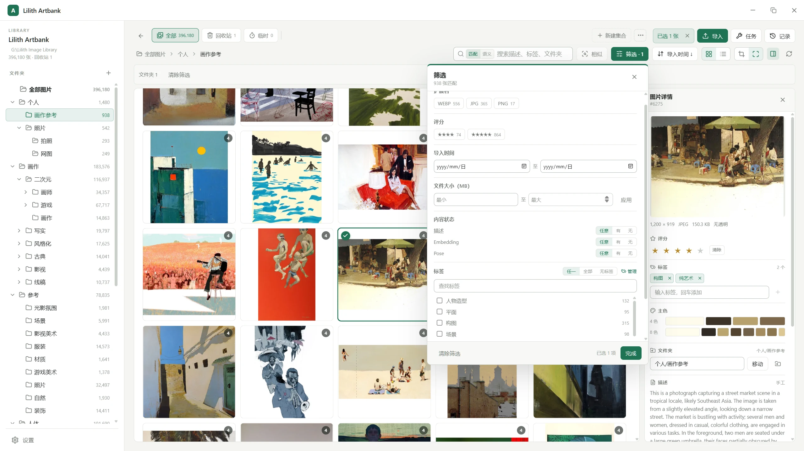

# Lilith Artbank

Lilith Artbank 是用于管理大量图片参考图的个人工具。它为**上百万张图片、数百 GB 文件**这一数量级设计，导入、浏览、检索、编辑与语义搜索全部在本机完成，不依赖任何在线服务。

> 本软件仅为个人工具，不为部署、数据迁移和安全、软件服务支持提供任何便利和承诺



## 主要功能

### 检索与理解

按内容而不是文件名找图是这套工具的重点。文本、语义、相似度与姿势四种方式都指向同一批图片，任何一次筛选或找相似的结果都可以就地收窄再继续，也可以直接存成集合。

- **排序与视图**：自适应列数的网格与固定行高列表；按导入时间、修改时间、评分、文件大小、像素尺寸、所在文件夹或集合内顺序排序，多级叠加后可存成排序方案。
- **文本搜索**：在描述、标签名与文件夹路径里查找，可以只看当前视图，也可以搜全库。
- **筛选**：按扩展名、评分、标签（任一/全部/无标签）、导入时间与大小范围、有无描述/向量/姿势筛选；打开面板时同时给出每个维度的命中数量。
- **找相似**：任意图片可设为参考，按画面哈希、主色、语义向量或人物姿势检索，支持多张平均成一个参考，并在此基础上继续收窄范围。
- **语义搜索**：直接用一句描述找图，不必先给图片写描述；与找相似共用同一套结果视图。
- **全库相似分组**：按画面或语义把整个图库聚成若干组，用来发现重复构图与同一作者的习惯，结果可整批存成集合。
- **向量与姿势生成**：为选中、当前视图或全库批量生成，有进度、取消与失败清单。
- **集合**：手工集合支持排序、加入移出与并集/交集/差集，也能把当前筛选或相似分组直接存成集合。

### 整理与编辑

- **图库与文件夹**：一个图库就是一个普通文件夹，里面的文件夹就是真实磁盘目录，可多级嵌套并保留空目录。左侧树支持多选、拖放移动、右键新建/重命名/删除，以及按名称或图片数排序整层。
- **导入**：文件选择、目录递归与窗口拖放三种输入，可平铺或保留源目录结构，落进指定文件夹并带上初始标签与评分。
  - 原图按内容命名，同一张图不会存两份：完全重复默认跳过或只合并元数据，同一批内的重复只留一份。
  - 可以先导进临时区看图、挑图，再决定是否入库；临时区在关闭、换库或退出时清空。
  - 也可以导入时就按质量档位重新压缩，此时不保留原图。
- **查看器**：全屏查看，支持适应窗口、1:1、滚轮缩放、拖拽平移、上下张与胶片带；大图与 TIFF/TGA 也能直接看。
- **几何编辑**：翻转、旋转、裁剪、调尺寸可任意组合，按「翻转 → 旋转 → 裁剪 → 缩放」的固定顺序执行，裁剪框跟着旋转与翻转走。
  - 保存不覆盖原文件，而是写入新文件并在一个事务里切换，旧图暂存以便撤销；标签、评分、描述与集合关系全部保留。
  - 输出前给出预计体积与“重新编码会损失画质”的提示，编辑过程有会话内撤销栈。
- **详情与批量编辑**：评分、标签、描述与所属文件夹；描述区分手工、导入与 AI 三种来源，批量编辑会区分“全部都有”和“部分图片有”的标签。
- **操作记录与撤销**：只有会改变图库内容的写操作才记录，批量操作只记一条。撤销是线性回退，撤销后可重做，新写入会开启新时间线；永久删除与清空回收站只做标记，等记录过期或清空后才真正删文件。
- **空间优化**：先只读估算能省多少空间、要跑多久，再决定是否执行；估算按源图类型抽样并给出误差区间，执行前复核候选与原图是否还在。压缩不可撤销。

### 可选能力

- **神经网络模型服务**：语义、向量与姿势能力由本机的模型服务提供，应用负责启动、探活与退出；不装模型时其余功能照常可用，相关按钮置灰。
- **MCP 图库控制**：把图库开放给支持 MCP 的 LLM 客户端，共 24 个工具，覆盖浏览、搜索、拼图、导入、写入、撤销/重做与任务查询。
  - 两种接法：应用内的本机 HTTP 服务（仅本机可达，带口令），或同一个 exe 的 `--mcp-stdio` 小桥。
  - 三档权限：只读、询问、完全。询问档会拦下导入、回收站、撤销/重做、文件夹移动删除、标签删除合并与超过 100 张的批量写入。

## 运行环境

- **操作系统**：Windows 10/11，WebView2 使用系统自带运行时。
- **模型能力可选**：需要语义、向量或姿势时才要 `python_embeded` 与 `resources\models`。

## 部署

程序以 Windows 便携文件夹分发，不生成安装器，目标电脑不需要 Node.js、Rust 或管理员权限。

1. 在开发机上运行 `npm run pack:portable`，得到 `release\Lilith Artbank`。程序包已经包含 `server`，不需要单独准备；它只是服务代码，必须配合 Python 环境才能启动 AI 服务。
2. 需要语义、向量或姿势能力时，按下一节把 `python_embeded` 与 `resources\models` 放进这个文件夹；不启用 AI 时跳过，导入、浏览、文本搜索与编辑都可以正常使用。
3. 把整个文件夹复制到目标电脑的本地可写目录，例如 `D:\Apps\Lilith Artbank`。设置、日志与 AI 服务输出都写在程序旁边，`Program Files` 等只读位置不可用。
4. 双击 `lilith-artbank.exe` 启动，首次运行选择或新建图库目录。图库是独立的普通文件夹，与程序目录分开。

目标电脑需要 WebView2 运行时：Windows 11 自带，Windows 10 通常已随 Edge 安装。

### Python 环境（可选）

语义、向量与姿势能力需要同目录的 `python_embeded` 与 `resources\models`。`python_embeded` 是 Python 3.11 + CUDA 12.1 环境，不随包分发。

已有可用的 conda 环境 `LilithArtbank` 时，用 conda-pack 打包：

```bash
conda install -n base -c conda-forge conda-pack   # 未安装时
conda-pack -n LilithArtbank -o python_embeded.zip
```

把 zip 解压到程序目录并命名为 `python_embeded`（根目录应有 `python.exe`），再运行一次 `python_embeded\Scripts\conda-unpack.exe`。

从零重建可用 `conda env create -f environment.yml -p "<程序目录>\python_embeded"`；如果 pip 阶段找不到 CUDA 版 torch，先设置 `PIP_EXTRA_INDEX_URL=https://download.pytorch.org/whl/cu121` 后重试，或按 `server\requirements.txt` 安装。

模型放到程序目录下的 `resources\models`，CLIP 默认读取其中的 `siglip2-giant-opt-patch16-384`。

## 开发与构建

需要 Windows + Node.js 24 + 稳定版 Rust 工具链 + Microsoft C++ 生成工具 + WebView2。

```bash
npm install
npm run tauri dev        # 真实窗口
npm run dev              # 浏览器预览（mock 数据，不写磁盘）
npm run typecheck
npm run build
npm run test:web
cargo test --manifest-path src-tauri/Cargo.toml
```

技术栈是 Tauri 2 + React 19 + TypeScript，元数据存 SQLite，图像管线在 Rust 侧完成。开发约定与目录边界见 [AGENTS.md](AGENTS.md)，性能基准与门槛见[性能基准](docs/guides/performance.md)。

## 文档

文档按读者分层，完整索引见 [docs/README.md](docs/README.md)。

- 想了解怎么用：本文件的功能介绍 + [当前阶段状态](docs/planning/current-handoff.md)（现在有哪些能力、规模基线）。
- 要改代码：先看 [AI 阅读引导](docs/architecture/ai-reading-guide.md) 选路由，再进[系统架构](docs/architecture/overview.md)或对应[模块文档](docs/README.md)。
- 要知道还差什么：[待办与待决策](docs/planning/todo.md) 是唯一的未完成清单，[路线图](docs/planning/roadmap.md) 写剩余阶段。
